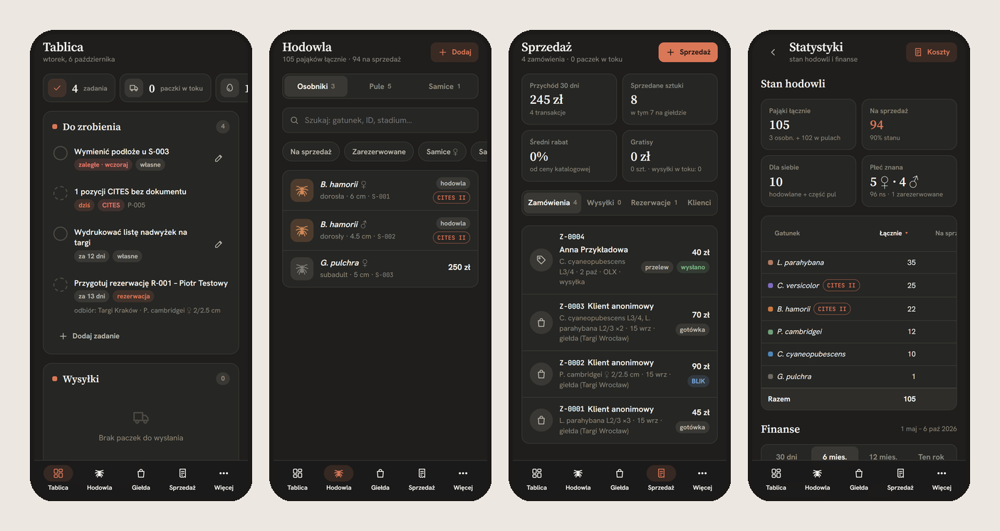
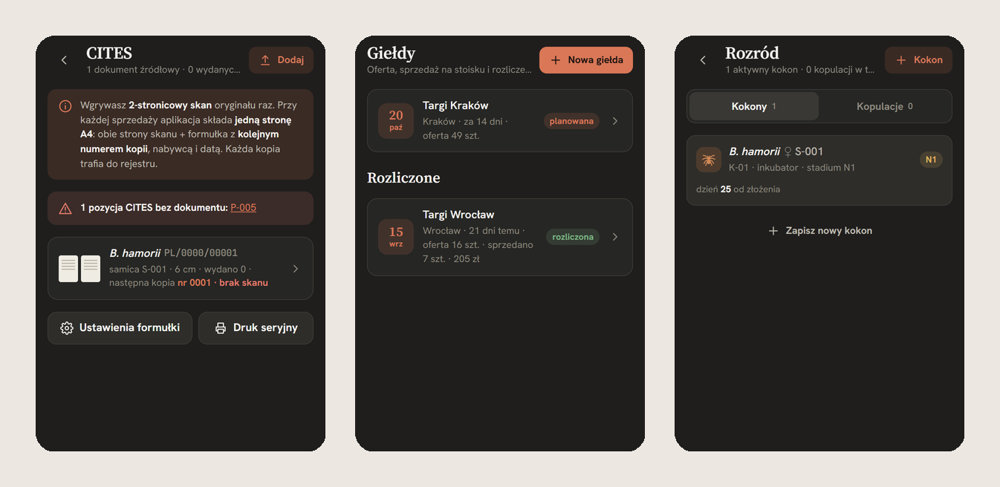
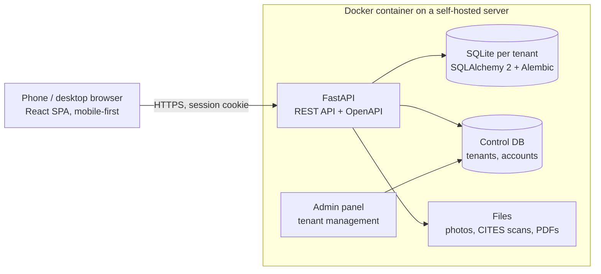

# Kokon: breeding & sales management for exotic-animal breeders

> **Showcase repository.** Kokon is a commercial product in development, so its source code is private.
> This page shows what it does and how it is built. A code walkthrough or live demo is available on request
> (mateusz.cza7@gmail.com).

Kokon is a mobile-first web app for tarantula breeders who sell at expos and online. It replaces the usual mix
of spreadsheets, notebooks and Messenger threads with a single place to run the business. Breeders use it to
track hundreds of spiderlings in shared "pools", sell them at expo stands from a phone, ship orders and keep the
legally required CITES paperwork in order.

It runs in production for a real breeding business. A multi-tenant hosted version is available to testers.

## What it does

| Area | Features |
|---|---|
| **Collection** | Individual specimens and *pools* of juveniles split into unsexed / ♀ / ♂, with molts, sexing, moving animals between pools, photos |
| **Breeding** | Pairings, egg sacs with incubation timeline, turning a hatched sac into a sale pool |
| **Expos** | Planning an expo, generating the offer, a fast point-of-sale "stand" mode for selling from a phone, end-of-day settlement |
| **Sales & shipping** | Orders, reservations, customers and purchase history, parcel tracking |
| **CITES documents** | Scans of source documents, numbered copies generated as PDF for every sale, a register of issued copies, warnings for animals missing paperwork |
| **Dashboard & stats** | Daily task board, revenue and cost statistics, stock per species |
| **Printing** | Stock lists for expos, labels and price tags (print-ready layouts) |
| **Import** | Bulk import of existing stock from Excel, with a dry run |

*The UI is in Polish (target market). All data in the screenshots is fictional.*

## Architecture

- **Backend:** Python, FastAPI, SQLAlchemy 2, Alembic migrations, Pydantic, SQLite (one database per tenant
  plus a control database in the multi-tenant edition), server-side PDF generation, rate limiting, maintenance mode
- **Frontend:** React, TypeScript, Vite, TanStack Query. API types are **generated from the OpenAPI schema**, so
  backend and frontend contracts cannot silently drift
- **Quality:** 160+ automated tests (pytest) covering domain rules, API, permissions and multi-tenancy; ruff;
  TypeScript type-checking; oxlint
- **Delivery:** Docker / docker-compose on a self-hosted Proxmox server. Branch flow `dev → stage → main`, where
  stage is a regression environment running only on simulated accounts (no real customer data, GDPR). Releases
  ship via an update script that announces a maintenance window to logged-in users. Automated backups
- **Scale of the codebase:** ~12k lines of Python, ~25k lines of TypeScript/TSX

## How it was built

Kokon was built by one developer working with **AI coding agents (Claude Code)** in a spec → implement →
review → test loop. I owned product decisions, domain modelling, architecture and acceptance, and verified
every change through tests and hands-on use in a real breeding business. AI agents did much of the typing.
The project is a practical case study in shipping a real product with AI-assisted development: writing precise
specs, keeping agents on track with tests and type contracts, and reviewing generated code.

## Product process

- Started from a clickable HTML prototype reviewed with the end user; features were cut or kept based on that review
- Iterative releases with an in-app **"What's new"** changelog shown once after each update
- Feedback from testers of the hosted version drives the roadmap

---

**Author:** Mateusz Czarny · [LinkedIn](https://linkedin.com/in/czarnymateusz/) · mateusz.cza7@gmail.com
